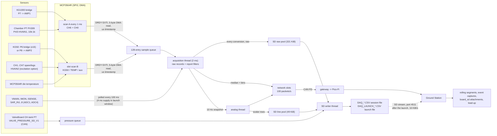

# DAQ data pipeline

This page follows every DAQ measurement from the sensor to the SD card and to
the Ground Station (GS). For each one it gives:

- rates and filters;
- scheduling;
- which file holds it;
- the network type;
- where the GS keeps it.

Values come from the code; each one names the file or macro it comes from. A
"model" value comes from the datasheet conversion-time table and the host
simulator; it has not been measured on hardware. Section 10 lists what a bench
run must confirm.

Related pages:

- [sd-record-format.md](sd-record-format.md): CSV columns and sensor names.
- [sd-log-sessions.md](sd-log-sessions.md): session and launch files.
- [sd-network-download.md](sd-network-download.md): SD file download.
- [loadcell-inputs.md](loadcell-inputs.md), [chamber-pressure.md](chamber-pressure.md),
  [analog-inputs.md](analog-inputs.md): wiring and scaling.
- [dac-validation.md](dac-validation.md): the DAC signal generator. See the DAC generator section below.
- GroundStation26 `docs/data-pipeline.md`: the station side, and every board.

## 1. Overview



**Fast channels.** These are the KG1000 thrust cell and the chamber PT.

- Each is converted at exactly 1 kHz, triggered by a timer.
- Every conversion is written to SD with a microsecond timestamp.
- The network gets 50 Hz values: the mean of each 20 ms bin of a 3-sample
  running median.

**Slow channels.** These are KG50, the die temperature, auxiliary inputs and
the board supply.

- They share the rest of the ADC time.
- Each still has every raw conversion on SD.
- Their published values are filtered more heavily.

## 2. The acquisition schedule

### 2.1 One 1 ms frame

TIM2 is a free-running 1 MHz counter and the acquisition clock. Its compare
channel 1 fires every `DAQ_ACQ_FRAME_US` (1000 µs) and starts scan A. Each
scan is one MCP3564R SCAN cycle in one-shot mode (CONFIG3 = 0xB0); at the end
of the cycle the ADC returns to standby.

The next scan's configuration is written as one 10-byte SPI DMA burst. The
burst starts at CONFIG0 = standby, so a register write can never restart a
running conversion. Compare channel 2 then starts the slot scan at a fixed
offset. The code is in `Core/Inc/daq_acq_schedule.h` and
`Core/Src/mcp3564r.c`.

Conversion time is a model: settled SINC3, `3 × OSR` DMCLK periods, doubled by
AZ_MUX; DMCLK = 16 MHz / PRE / 4.

| Profile | Scan A (KG1000 + chamber) | Slot start | Slot item | Frame end (model + margins) |
|---|---|---|---|---|
| FILL (default) | OSR 128, 2 × 192 µs = 384 µs | 436 µs | KG50 / aux: OSR 256, 384 µs; TEMP: MCLK/4, OSR 64, 384 µs | 872 µs |
| LAUNCH | OSR 256, 2 × 384 µs = 768 µs | 832 µs | KG50 / aux: OSR 64, 96 µs | 971 µs |

The margins are 3 % plus 10 µs per scan, an 8 µs read, a 12 µs configuration
burst and a 10 µs settling gap. `_Static_assert`s reject a frame that does not
fit in 1 ms.

```mermaid
gantt
  title FILL frame (us from the TIM2 compare)
  dateFormat X
  axisFormat %L
  section ADC
  START A (CH6 then CH0, OSR128)  :a1, 0, 384
  read CH0, write slot config     :a2, 384, 410
  settle                          :a3, 410, 436
  slot: KG50 P6 x16, OSR256       :a4, 436, 820
  read, write scan A config       :a5, 820, 846
  idle until next tick            :a6, 846, 1000
```

```mermaid
gantt
  title LAUNCH frame (us from the TIM2 compare)
  dateFormat X
  axisFormat %L
  section ADC
  START A (CH6 then CH0, OSR256)  :a1, 0, 768
  read CH0, write slot config     :a2, 768, 794
  settle                          :a3, 794, 832
  slot: KG50 P6 x16, OSR64        :a4, 832, 928
  read, write scan A config       :a5, 928, 954
  idle                            :a6, 954, 1000
```

### 2.2 The 10-frame slot pattern

The slot item is a pure function of the frame number (`daq_acq_slot_item`).
The pattern repeats every 10 frames (10 ms):

| Frame mod 10 | FILL | LAUNCH |
|---|---|---|
| 0–7 | selected KG50 (P6 at ×16, or AMP2 CH1) | selected KG50 |
| 8 | MCP3564R die temperature (MCLK/4) | selected KG50 |
| 9 | one auxiliary channel (rotation below) | one auxiliary channel |

**Auxiliary rotation.** It has `DAQ_ACQ_AUX_ROTATION` = 10 entries, one every
10 ms, so it repeats every 100 ms (`daq_acq_aux_items`).

- CH2 and CH3 (the P6 legs) open each half of the rotation, back to back, so
  every 50 ms there is a CH2/CH3 pair 10 ms apart.
- The other channels fill the remaining slots in turn:
  - with P6 selected: CH1, CH4, CH5, CH7;
  - with AMP2 selected: CH4, CH5, CH7.
- Each auxiliary channel is converted at least every 100 ms.
- A fast channel or the selected KG50 input never appears in the rotation.

**Profile switching.**

- **LAUNCH** follows `sd_card_launch_window_active()`: from 0.5 s before the
  launch window opens (Launch acceptance, at most 15 s before T0) until it
  closes at T+20 s.
- **FILL** applies at all other times.
- The thread requests the profile every 2 ms and the frame engine applies it
  at the next frame.
- The fast pair's frame tick never moves. Its conversion midpoint moves once
  at a switch: CH6 from 96 to 192 µs and CH0 from 288 to 576 µs after the
  tick. The timestamps account for this.

### 2.3 Why the 4 Hz and 10 Hz lines were there, and why they are gone

The investigation (GroundStation26 `docs/loadcell-investigation-2026-11.md`)
found lines at 4 Hz, 10 Hz and their harmonics, about 0.1 kg. The former
pipeline (origin/dev 6f29611) had three periodic irregularities:

1. **The 2 ms worker reprogrammed the ADC.**
   - Every 100 ms it ran a temperature pass at a different clock (MCLK/4) and
     an auxiliary CH2–CH7 pass.
   - With P6 selected (every site session), it also alternated the whole fast
     scan with the P6 gain-16 scan every 2 ms cycle.
   - So the fast channels were sampled in bursts: about 500 Hz on average, with
     2 ms holes every 4 ms and 3–6 ms holes every 100 ms.
   - Any settling after a clock or gain change repeated every 100 ms, which
     gives a 10 Hz line and harmonics.
2. **The network sent the latest 4 ms bin in a weighted interleave.**
   - Weights 10/10/1/1/1/1/1 over 100 slots/s give a 25-slot pattern that
     repeats every 250 ms. KG1000's slots were unevenly spaced within it.
   - Sampling the 10 Hz artefact at those instants put lines at every
     multiple of 2 Hz, 4 Hz among them.
3. **Timestamps had 1 ms resolution.** At 868 Hz, several conversions shared
   one millisecond.

The new schedule removes all three:

- **One fixed pattern.** Every 1 ms frame starts on the TIM2 compare, and the
  10-frame pattern never changes within a profile.
  - The fast channels' conversion instants are strictly periodic.
  - Every frame has the same ADC history: the same gain and clock changes at
    the same places.
  - Any settling artefact is therefore either constant (removed by tare) or
    periodic at 100 Hz or faster.
  - Every report bin (20 ms, 50 ms) holds whole patterns, so the bin means
    average such an artefact out completely.
- **The temperature conversion is pinned.** It is the only scan on a different
  clock, and it sits in frame 8 of every 10. It was not moved to a 10 Hz or
  1 Hz slot on purpose: that would recreate a line at that rate.
- **Every load-cell bin is sent.** The fast pair and KG50 bins each get a slot
  as soon as they are complete, dated at the bin centre. The received stream is
  uniform: 20 ms and 50 ms.
- **Microsecond timestamps.** Each sample is stamped at its conversion
  midpoint.

**Verification.** `tests/test_spectral_lines.py` drives the same artefact model
through both pipelines over 120 s. The model has two parts: an offset on the
conversion after any configuration change, and a disturbance that decays over
3 ms after every slow-clock conversion.

- **Former model:** lines stand 18× (10 Hz), 9× (4 Hz), 11× (6 Hz) and 26×
  (20 Hz) above the neighbouring noise floor in a Welch spectrum.
- **New pipeline:** the production frame engine in the host simulator, then
  the published median and bins. The spectrum is flat: 0.7–2.0× at 2, 4, 6, 8,
  10, 12 and 20 Hz. The test fails above 2.5×.

This is a model. On hardware, compare the spectrum of the published KG1000 at
rest before and after this change (Section 10).

A third mechanism cannot be excluded: periodic board activity coupling
electrically into the analog front end. This includes CAN transmissions, the
10 Hz analog snapshot and SD writes. The new network pattern still has
periodic structure:

- the fast pair every 20 ms;
- KG50 every 50 ms;
- the auxiliary interleave in the remaining slots.

If a bench capture still shows a line at 10 Hz or 5 Hz after this change, the
cause is electrical, not scheduling. The investigation's grounding work then
applies (hardware item 1).

## 3. Threads, interrupts, timers and DMA

| Context | Priority | Trigger / period | Work |
|---|---|---|---|
| TIM2 IRQ (CC1, CC2) | NVIC 0 | CC1 every 1000 µs; CC2 at the slot offset | Frame tick: claim SPI, START scan A (1-byte DMA); slot START. A scan still waiting for DRDY at the next tick is restarted (counted) |
| GPDMA1 ch0/ch1, SPI2 EOT IRQ | NVIC 0 | end of each SPI DMA | Read completion: validate STATUS, queue the sample with its µs time; after a scan's last channel, start the next configuration burst. Config/START completions chain the state machine |
| EXTI10 (ADC DRDY, PB10) | NVIC 5 | falling edge after each conversion | Timestamp (TIM2), claim the SPI with interrupts masked, start a 5-byte read DMA (or mark it pending) |
| TIM6 (HAL tick) | NVIC 15 | 1 ms | `HAL_GetTick`; TIM2's offset to it is measured once at start |
| FDCAN1, USART1 | NVIC 6 | traffic | Network |
| SDMMC1 | NVIC 7 | card transfers | SD |
| DAC timers TIM7/TIM15, GPDMA ch10/11 | — | DAC waveform | DAC generator only; acquisition never uses them |
| Acquisition thread "DAQ Thread" | ThreadX 5 (highest app) | every `DAQ_ACQUISITION_PERIOD_MS` = 2 ms | Drain up to 11 conversions; SD raw records; median filters and report bins; input-fault observations; ADC1 supply in the launch window; profile request; driver service (DMA-stall/recovery, missed DRDY). 32 KiB stack |
| "Live sensor network" | 6 | 1 ms sleep | One slot per 1/`DAQ_NETWORK_RATE_HZ`: fast-pair bin, else KG50 bin, else auxiliary interleave; DAC service |
| "Analog reporting" | 6 | queue (10 Hz) | Publish SDADC/SAR/current/power; queue the 21 scalar SD rows |
| Telemetry thread | 6 | router loop | SEDSnet router, health reports (DAQ_INPUT_HEALTH 1 Hz, early on a new fault), SD/launch status. 32 KiB stack |
| SD writer | 7 | events, flush 1 s | Format and write CSV rows; 16 KiB staging per open log; `fx_media_flush` every second, on open/close and on a power-loss notice |

All ADC interrupt work is non-blocking. Blocking SPI only happens in thread
context with the frame engine stopped: device reset and setup at init, and
recovery after a STATUS fault or a DMA stall longer than 20 ms. TIM2 and SPI2
GPDMA channels 0/1 are the only acquisition resources. The DAC generator owns
TIM7, TIM15 and GPDMA channels 10/11.

### 3.1 Jitter and CPU load

**Fast-channel timing.** The fast channels' sample instant is the TIM2 compare
plus a fixed offset, so there is no scheduling jitter in the samples
themselves.

- The START command is issued in the TIM2 interrupt, behind at most one
  running priority-0 handler (a few µs).
- `g_mcp3564r_diag.start_late_max_us` records the worst START latency.
- Each sample's timestamp is its DRDY edge time (EXTI, NVIC 5) minus half the
  modelled conversion time. Timestamp uncertainty is the EXTI latency (µs)
  plus the model error.
- In the simulator (zero interrupt latency), start lateness is 0 µs. The scan
  ends at most 386 µs (FILL) and 770 µs (LAUNCH) after the tick; the slot ends
  822/930 µs after it.
- With conversions 3 % slower than modelled, scan A ends at 398/794 µs and the
  slot at 834/933 µs, with no skips.
- At 12 % slower, LAUNCH slots are skipped and counted; the fast pair stays
  exact.

**CPU load.** These are estimates, not measured.

- **ADC interrupts:** about 30 µs per frame, which is 3 % of the CPU. That
  covers per frame:
  - a TIM2 tick;
  - three DRDY + read completions;
  - two configuration and two START completions.

  The former driver used about 1.5 % for interrupts, but ran its blocking
  reconfiguration SPI in the thread.
- **SD formatting:** about 4.1k instructions per row, or 26–38 µs
  (`docs/sd-write-path.md`). At 3000 rows/s that is 8–11 % of the CPU (3500/s
  in the launch window: 9–13 %), against 5–8 % for the former 2610 rows/s.
- **Report filters** (medians of 3/5, bins, statistics): about 2 µs per
  sample, under 1 %.

### 3.2 RAM and flash

Release build, `arm-none-eabi-size`, against origin/dev 6f29611:

| | Before | After | Delta |
|---|---|---|---|
| RAM (data + bss, linker) | 775 592 B | 776 488 B | +896 B |
| Flash (ROM, linker) | 904 480 B | 907 976 B | +3 496 B |
| RAM free of 768 KiB | 10 840 B | 9 944 B | |

The RAM is the medians (11 × 32 B), report bins, per-channel noise/drift state
(4 × 88 B) and the latest auxiliary values. The 128-entry sample queue keeps its
size (16-byte entries). The acquisition thread's raw batch on its stack shrinks
from 16 to 11 records.

## 4. Per-channel table

**Column notes:**

- "Rate" is conversions per second.
- "SD" means every conversion is a raw record in the open file:
  - the ordinary session file `DAQ_<time>_<seq>.CSV`;
  - from Launch acceptance to T+20 s, the launch file `DAQ_LAUNCH_*.CSV`.
- "BW" is the usable bandwidth of the published value. A boxcar of length T is
  −3 dB at 0.443/T.
- Latency runs from the moment a report bin closes (its last conversion) to
  the packet leaving the DAQ, worst case. Add the bin length for the oldest
  sample in the bin.

| Channel | Sensor / input | ADC, mux, gain | Rate, filter | SD record (sensor, units) | Published (SEDSnet type, rate, filter, BW) | Egress | Latency (published) |
|---|---|---|---|---|---|---|---|
| CH0 | KG1000 bridge → AMP1 (P7), ×100.9 | MCP3564R, scan A, gain 1, AZ_MUX | 1000/s; sinc3 OSR 128 (FILL) / 256 (LAUNCH) | `kg1000_v`: ADC-pin V; calibrated kg; µs time | `DAQ_LOADCELL_CHAMBER[0]` (or `KG1000`), 50/s: mean of 20 ms bin of 3-sample median, centre-stamped; BW ≈ 22 Hz | Fast slot class, priority 16, unreliable | bin 20 ms + ≤ 15 ms |
| CH6 (default) | Chamber PT PX309-1KG5V, P4/3 HVAIN1, 10k:1k, buffer | scan A, gain 1, AZ_MUX | 1000/s; same | `chamber_pressure_v`: connector V; psig | `DAQ_LOADCELL_CHAMBER[1..2]` psig, V, 50/s, same filter; also `DAQ_SDADC_VOLTAGES[4]` at 10 Hz | with KG1000 | bin 20 ms + ≤ 15 ms |
| CH9 (P6) | KG50 bridge, P6/3 − P6/4, direct | slot, gain 16, AZ_MUX | 800/s FILL (OSR 256), 900/s LAUNCH (OSR 64) | `kg50_p6_v`: input V | `DAQ_KG50_SELECTED [1, V]`, 20/s: mean of 50 ms bin of 5-sample median; BW ≈ 9 Hz, 60 Hz mains nulled | KG50 slot class, priority 16 | bin 50 ms + ≤ 17 ms |
| CH1 (AMP2) | KG50 alternative, P8 → AMP2 | slot, gain 1 | 800/s / 900/s when selected; else 20/s auxiliary | `kg50_v`: ADC-pin V; calibrated kg | `KG50`, 20/s, same as P6 | KG50 slot class | bin 50 ms + ≤ 17 ms |
| CH2, CH3 | P6 legs S+, S− (single-ended) | slot, gain 1 | 20/s each (pairs 10 ms apart every 50 ms) | `mcp3564r_ch2_v`, `_ch3_v`: ADC-pin V | `DAQ_SDADC_VOLTAGES[0..1]`, 10 Hz, latest 3-sample median | Weighted interleave, priority 0 | ≤ 250 ms |
| CH4, CH5, CH7 | spare inputs; CH7 = HVAIN2 (10k:1k) | slot, gain 1 | 10–20/s (rotation) | `mcp3564r_chN_v`: ADC-pin V; connector V | `DAQ_SDADC_VOLTAGES[2,3,5]` 10 Hz, latest 3-sample median, NaN after 300 ms | interleave | ≤ 400 ms |
| CH7 as excitation | +9V6A_LC via P4/4, when wired (`DAQ_EXCITATION_ADC_CHANNEL=7`) | slot, gain 1 | 10/s | `excitation_v`: connector V | `DAQ_INPUT_HEALTH` word 13 (noise/drift), 14 (mV min/now) | 1 Hz report | ≤ 1 s |
| TEMP | MCP3564R die sensor | slot, MCLK/4, OSR 64 | 100/s FILL; none in LAUNCH | per raw row (`adc_temperature_c/_code`, on change); `mcp3564r_temp_c` scalar 10 Hz | `DAQ_ADC_TEMPERATURE` 10 Hz offered | interleave | ≤ 2 s fresh (60 s in LAUNCH) |
| VMAIN, IMON | ADC1 PB2/PB1 (VMON divider, LM74202) | STM32 ADC1, 391.5-cycle sample | 10/s; 250/s in launch window (+0.5 s pre-roll) | `input_voltage_v`, `input_current_a` raw records (ms time) | `DAQ_POWER_MONITOR` 10 Hz offered | interleave | ≤ 300 ms |
| ISENSE1/2, SAR_IN1..8, ADC1 aux | ADC1 (CH5–8, 11, 12), ADC4 (CH1–4) | polled | 10/s | scalar rows `isense*`, `analog_in_*`, `adc1_aux_v` | `DAQ_CURRENT_SENSE`, `DAQ_SAR_VOLTAGES` 10 Hz offered | interleave | ≤ 300 ms |
| DAC readback | ADC4 | polled while a DAC channel runs | 10/s | `analog_out_*_v` scalar rows | `DAQ_DAC_STATUS` | | |
| VB OX-tank PT | ValveBoard ADC3 at 500 Hz, archived 250 Hz | over CAN, `VALVE_PRESSURE_SD_V1` (4 samples/packet) | 250/s | `valve_pressure_psi` (ADC code, psi), routed by VB capture time | not re-published (VB sends `FUEL_TANK_PRESSURE` 50 Hz itself) | | |

**Rate notes:**

- "Offered" auxiliary rates (10 Hz) are what the analog thread offers.
- The network sends them at their interleave share of the 30 slots/s that the
  load cells leave. With weights 1/2/1/1/2, that is about 4–9 per second each.
- The newest value always wins.

**Calibration:**

- Load cells are published uncalibrated, in ADC-pin volts (P6: input volts).
  The GS applies its calibration.
- The SD `calibrated_value` uses the on-board copy that the GS sends
  (`DAQ_LOADCELL_CALIBRATION`, `DAQ_KG50_CALIBRATION`); a `# calibration`
  line records it.
- Chamber psig = connector V × 200, with a 4.5 psi reporting floor
  (`daq_chamber_pressure.h`).

## 5. Before and after, per channel

The baseline is origin/dev 6f29611. "Field" means P6 selected (every site
session in the investigation); "AMP2" means the AMP2 input.

The noise figures compare ADC integration time:

- Per-sample noise scales with 1/√(integration time).
- Noise density in a fixed band scales with 1/√(integration time × rate).
- The investigation measured 0.03–0.2 kg per sample at the site, mostly
  front-end and mechanical. The ADC's share is small for the amplified
  KG1000/AMP2 paths.

| Channel | Before: rate and timing | After: rate and timing | Bandwidth (Nyquist / published) | Noise | Latency |
|---|---|---|---|---|---|
| KG1000 | Field: ~500/s in 2 ms bursts, 3–6 ms holes every 100 ms, ms stamps. AMP2: 868/s, holes every 100 ms | 1000/s strictly periodic, µs stamps, both profiles | 250–434 Hz, uneven → 500 Hz uniform. Published: 4 ms bins picked at ~40 Hz (aliased, 250 ms pattern) → 20 ms bins every bin at 50 Hz | Density vs field: FILL equal, LAUNCH ×0.71. Vs AMP2: FILL ×1.32, LAUNCH ×0.93. Per sample FILL ×1.41 (OSR 128); published: 20 samples per value vs ~3.5 | Bin 20 ms + ≤ 15 ms, every bin sent (was a 4 ms bin + up to ~25 ms for an uneven slot, most bins never sent) |
| Chamber PT | Same as KG1000 (in the fast scan) | 1000/s, as KG1000 | as KG1000 | as KG1000. Burn (LAUNCH) is better on every axis | as KG1000 |
| KG50 P6 | ~1.25 kHz bursts in alternate 2 ms cycles (~0.45 s/s integration), 4 ms bins at ~40 Hz | 800/s FILL (0.31 s/s), 900/s LAUNCH (0.09 s/s), uniform with a 3 ms hole per 10 ms | Published 4 ms/40 Hz → 50 ms bins/20 Hz (BW 9 Hz, mains rejected). The fill-mass rate needs < 1 Hz | ADC share FILL ×1.2, LAUNCH ×2.3 per unit time. Published values average ~40 samples vs ~5, so published noise ~2.8× lower for white noise. ADC share ≈ 0.02 kg/sample at ×16 OSR 256, about 0.003 kg per published value | Bin 50 ms + ≤ 17 ms (was 4 ms bin + up to ~25 ms) |
| KG50 AMP2 | 868/s, OSR 256 (0.33 s/s) | 800/s OSR 256 (0.31 s/s); LAUNCH 900/s OSR 64 | as P6 | FILL ×1.04, LAUNCH ×2.0 | bin 50 ms + ≤ 17 ms |
| CH2/CH3 (P6 legs) | 1 sample per 100 ms pass, OSR 256 | 1 per 50 ms each, OSR 256 (FILL) / 64 (LAUNCH) | 5 → 10 Hz Nyquist | median of 3 published; health uses the raw value | Leg fault: observation every 50 ms (was 100 ms) |
| CH4/CH5/CH7, CH1 when unused | 1 per 100 ms | 1 per 50–100 ms | ≥ same | ≥ same per sample (OSR 256, FILL) | Published value is a 3-sample median: up to one sample older than before |
| Temperature | 1 per 100 ms, MCLK/4 OSR 256 | 1 per 10 ms FILL (MCLK/4, OSR 64); none in LAUNCH | ample for display | per sample ×2 (OSR 64), 10× more samples | 10 Hz published, as before; held 60 s in LAUNCH |
| Supply, internal ADCs | unchanged | unchanged | | | |

**What got worse, and why it is acceptable:**

- **FILL fast-channel noise density versus AMP2-mode** (×1.32). Thrust and
  chamber pressure are not needed during fill. Against the field baseline (P6)
  it is equal, at twice the rate and with uniform timing. During the burn
  (LAUNCH) both fast channels beat both baselines.
- **The KG50 ADC share during the launch window** (×2.3). The burn unloads the
  cell and fill control is over. The published 50 ms values still average 45
  samples.
- **The KG50 ADC share in FILL** (×1.2). The ADC is not the dominant KG50 noise
  (investigation §2.2: 0.03–0.1 kg mechanical versus ≈ 0.003 kg ADC per
  published value). Published noise falls because each value averages 40
  samples instead of 5.
- **Auxiliary display latency**, up to one sample from the 3-sample median.
  None of these channels drives an abort or control.

## 6. Filters on published values

| Stream | Filter | Delay | Step response | Spike response |
|---|---|---|---|---|
| Fast pair | 3-sample running median (1 kHz), then mean of fixed 20 ms bins | median 1 ms; bin centre-stamped, so the report goes out ~10 ms after the centre plus ≤ 2 ms drain and ≤ 10 ms slot | A step reaches the median output after 2 samples, with no intermediate value. The bin holding the step carries the partial mean; the next bin carries the full value (`test_report_filters.py`) | Any single-sample spike is removed |
| KG50 | 5-sample running median (800–900/s), then mean of fixed 50 ms bins | median 2 samples (~2.2 ms) | as above, 3 samples | Up to 2 consecutive spike samples removed |
| Auxiliary CH1–CH7 | 3-sample running median of each channel's samples | 1 sample (50–100 ms) | | single spike removed |
| GS display | first-order low-pass, `noise.<sensor>.tau_ms` (0–2000 ms, GS `loadcell_zero`) | tau | | |

**SD keeps every unfiltered conversion.** The network values are exactly
reproducible from SD:

- same median, same µs bins, double-precision sum, one binary32 rounding;
- `tests/test_launch_supply_log.py` rebuilds every emitted bin bit for bit
  from formatted SD rows.

The on-board `filter_tau_ms` low-pass applies only to the SD
`calibrated_value` of KG1000/AMP2. The raw value is always unfiltered.

### 6.1 Safety and health checks

The DAQ has no abort authority. Overpressure, relief and abort are ValveBoard
functions on its own PT (ValveBoard26 `docs/data-pipeline.md`).

The DAQ's checks are operator warnings in `DAQ_INPUT_HEALTH`. They run on raw
2 ms window means (not the median stream), with the existing time debounce:

| Check | Input | Observation rate | Set time | Latency |
|---|---|---|---|---|
| Supply low (12.5 V) | VMAIN | 10 Hz; 250 Hz in the launch window | 100 ms | unchanged |
| KG1000/KG50 rail | window means | every 2 ms | 20 ms | unchanged; observations are now uniform |
| P6 leg imbalance / common mode | CH2/CH3 pairs | every 50 ms (was 100 ms when the pass fitted one window) | 100 / 200 ms | ≤ set + 50 ms (was set + 100 ms) |
| Chamber no signal (burn window) | chamber window means | every 2 ms (was 10 Hz in the original design) | 2000 ms | unchanged |

`tests/test_report_filters.py` checks four cases:

- a real clip trips at exactly 20 ms;
- one conversion at the rail does not even count an episode;
- a 2 ms window at the rail counts but does not activate;
- a dead PT activates at T0 + 3.5 s, while one-sample dropouts on a live PT do
  not.

**DAQ_INPUT_HEALTH version 2.** It has 18 words (`daq_input_faults.h`). Version
2 adds:

- per-channel noise (1 s RMS of successive differences / √2) and drift (change
  of the 10 s mean over 60 s, per minute) for KG1000, KG50, the chamber PT and
  the excitation monitor;
- excitation mV;
- frame-engine counters: frames skipped, slots skipped, scans restarted,
  device recoveries;
- the latest scan-end times.

## 7. SD card

**Files.**

- Regular session files: `DAQ_<network-time>_<seq>.CSV` in `/UTC` or `/NO_UTC`.
- Launch files: `DAQ_LAUNCH_<network-time>_<seq>.CSV` in `/LAUNCH`.
- A launch file runs from Launch acceptance (when the `DAQ_LOG_CLOCK` deadline
  arrives; at most 15 s before T0, `SD_LAUNCH_LEAD_MAX_MS`) to T+20 s
  (`SD_LAUNCH_WINDOW_MS`).
- With both clocks known, rows are routed by capture time, so neither
  transition loses or duplicates a row.
- Files split only before 3 GiB.
- Details: [sd-log-sessions.md](sd-log-sessions.md).

**Rows.** The format is the 13-column CSV in
[sd-record-format.md](sd-record-format.md).

| Row type | Rate | Clock |
|---|---|---|
| MCP3564R raw records (fast pair, slot items) | 3000/s | `uptime_ticks` in µs, `uptime_frequency_hz=1000000` |
| Supply raw records | 20/s; 500/s in the launch window | ms |
| Scalar snapshot rows (21 per 100 ms; optional, shed whole under backpressure) | 210/s | ms |
| VB pressure rows | 250/s | VB clocks |
| `# calibration` | on change | |

- Temperature columns repeat only when the value changes.
- Average row ≈ 125–135 B. That is ≈ 0.42 MB/s, or ≈ 0.48 MB/s in the launch
  window (former: ≈ 0.36 MB/s).

**Buffers and loss.**

- **Raw pool:** 321 KiB of compact 40-byte records (about 2 s at 3500/s,
  sized for at least `DAQ_SD_RAW_BUFFER_MS` = 800 ms).
- **Line pool:** 49 KiB.
- **Pressure queue:** 32 batches.
- Each open log stages rows in a 16 KiB aligned buffer. The media is flushed
  every second, on file open and close, and on a power-loss notice (VMAIN
  ≤ 8.5 V).
- **On power loss** the unflushed tail is lost: up to about 1 s of rows plus
  the queued raw records.
- **Optional rows** (scalar snapshots and non-essential raw channels) are shed
  once the raw backlog exceeds 500 ms at 1.5× the nominal rate
  (`SD_OPTIONAL_RAW_ADMIT_LIMIT`). The fast pair, KG50 and supply are
  essential and are never shed.

**SD throughput** (`tests/test_sd_throughput.py`, a model of the production
writer and FileX against a virtual card, with a 400 ms stall every 4 s):

- 5250 records/s (1.5× the launch-window rate) pass with no loss at 2, 6 and
  10 ms per card command.
- At 15 ms per command, 4550/s (1.3×) passes.
- Steady capacity at 6 ms per command is ≈ 5490 records/s.
- The former schedule offered 2410/s; the 1 kHz schedule offers 45 % more.
  Margin on the slowest modelled card is 1.3× instead of 1.5×.

**On the GS.**

- After a launch capture, the GS downloads `/LAUNCH` over the fill link at
  16 KiB/s. A ~30 s launch file of ≈ 13 MB takes about 14 min (former:
  ≈ 10 MB, 10 min).
- The 60 s lead-up from the session file is cut by range reads at 8 KiB/s
  (≈ 22 MB of rows in that window). It comes from a local copy when one
  exists.
- See GroundStation26 `docs/data-pipeline.md` §3.3–3.5.

## 8. Network

The live sensor scheduler is `daq_network_schedule.h` and
`daq_network_config.h`.

- The cap is `DAQ_NETWORK_RATE_HZ` = 100 slots/s, at least 80. A stalled worker
  gets one slot, never a burst.
- The load-cell classes use 70/s. The auxiliary interleave keeps ≥ 30/s.
- Heartbeats, ACKs, commands and discovery bypass the scheduler.

| Class | SEDSnet type | Rate | Payload | Priority / reliability |
|---|---|---|---|---|
| Fast pair | `DAQ_LOADCELL_CHAMBER` (or `KG1000` when no chamber channel or no matching chamber bin) | 50/s, every bin | [KG1000 V, chamber psig, chamber V] | 16, unreliable |
| KG50 | `KG50` (AMP2) / `DAQ_KG50_SELECTED` (P6, [1, V]) | 20/s, every bin | | 16, unreliable |
| Interleave | `DAQ_ADC_TEMPERATURE` (w 1), `DAQ_SDADC_VOLTAGES` (2), `DAQ_SAR_VOLTAGES` (1), `DAQ_CURRENT_SENSE` (1), `DAQ_POWER_MONITOR` (2) | remaining slots by weight, newest value wins | | 16 / 0, unreliable |
| Outside the cap | `DAQ_INPUT_HEALTH` (1 Hz, early on a new fault), `DAQ_SD_HEALTH`, `DAQ_LAUNCH_LOG_STATUS`, `BOARD_HEALTH`, `DAQ_DAC_STATUS` | | | |

The packet time is the capture time: the bin centre for load cells. A KG1000
bin waits at most one 2 ms cycle for the chamber bin with the same centre;
without one, the scalar `KG1000` is sent and absence is never a zero.

**Full-rate data comes from SD.** The network carries 20/50 ms bins. The
1 kHz thrust and chamber traces for the burn impulse are the DAQ SD launch
file:

- the station attaches it to the launch capture automatically;
- the lead-up comes from the session file;
- integrate `raw_value` × calibration over `uptime_ticks / uptime_frequency_hz`.

## 9. Where each stream ends up on the GS

| Stream | DAQ SD | GS live and recorded |
|---|---|---|
| KG1000, chamber PT | every conversion (1 kHz, µs) | 50 Hz bins → decoded rows `KG1000`, `LOADCELL_WEIGHT_KG`, `COMBUSTION_CHAMBER_PRESSURE`/`VOLTAGE`/`RANGE_STATUS` in the rolling SQLite segments (64 MB, 50 GB ring); copied into event captures (launch: 600 s before, 300 s after); test-fire CSV |
| KG50 | every conversion (800–900/s) | 20 Hz bins → `KG50`, `LOADCELL_50_WEIGHT_KG`, `LOADCELL_FILL_PERCENT`; captures (fill: 120 s / 120 s) |
| Auxiliary, temperature, supply, internal ADCs | raw records / scalar rows | the interleave's share (≈ 4–9/s each) as decoded rows |
| Input health | | `DAQ_INPUT_HEALTH` payload rows, alerts, Board status block |
| VB OX-tank archive | 250 Hz `valve_pressure_psi` | not sent to the GS (the VB's own 50 Hz `FUEL_TANK_PRESSURE` is) |
| Full-rate files | `DAQ_LAUNCH_*.CSV`, session files | `/LAUNCH` downloaded after a launch capture and attached as `board_sd/DAQ/<file>` with a 60 s `.leadup.csv`; any file can be imported by hand, and the SD resolver maps it into the recording (`recording_sd_resolve.py` profile `daq-20261123`, which rebuilds the 20/50 ms bins from µs rows) |

The burn report is not on GroundStation26 dev yet; its design is on branch
`burn-report`. Its DAQ reader must use `kg1000_v`, `chamber_pressure_v` and the
µs `uptime_ticks`.

## 10. What a bench run must confirm

Nothing here has run on hardware. Before relying on it:

1. **Conversion times.** Read `g_mcp3564r_diag` or `DAQ_INPUT_HEALTH` words
   15–17.
   - `fast_done_max_us` should be ≈ 384/768 and `slot_done_max_us` ≈ 820/930.
   - Skipped frames/slots should stay 0.
   - If slots skip in LAUNCH, raise the slot offset margin.
2. **Fast-pair spacing.** In an SD file at rest, successive `kg1000_v`
   `uptime_ticks` must differ by exactly 1000 µs, apart from profile switches.
3. **Spectrum.** Compare the published KG1000 and KG50 at rest, and the
   1 kHz SD data, for lines at 2–20 Hz against the old firmware. A line that
   remains points at electrical coupling (§2.3).
4. **Settling.** At rest, compare CH0/CH6 values in frames that follow an
   auxiliary slot with the others. Any difference repeats at 100 Hz and is
   removed by the bins.
5. **SD.** Raw-drop counters must stay 0 through a launch window on the
   flight card.
6. **The temperature reading** at MCLK/4 with OSR 64. It should agree with the
   former OSR 256 reading within noise.

The Renode MCP3564R model (FirmwareSimulator `renode/peripherals/SedsSpiSensors.cs`)
converts continuously and does not model one-shot SCAN or TIM2 frames. Update
it before running the Renode full-network test with this firmware.

## DAC generator

See [dac-validation.md](dac-validation.md). DAC1 waveforms use TIM7/TIM15 and
GPDMA channels 10/11. Readback goes through ADC4 at the 10 Hz analog pass, and
status goes in `DAQ_DAC_STATUS`. The acquisition schedule uses none of these
resources, and the DAC uses none of the acquisition's: TIM2 and GPDMA channels
0/1.
